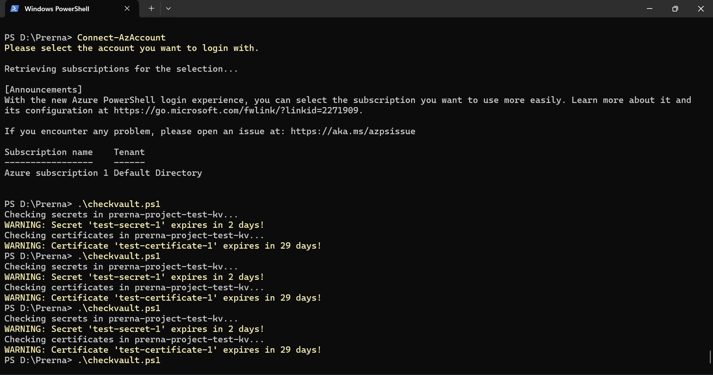

# Azure Key Vault Expiry Monitor


A PowerShell automation that scans an **Azure Key Vault** for **secrets and certificates nearing expiry** and sends an **SMTP email alert** for each one, replacing manual expiry tracking with a repeatable, auditable check.

> **Why this matters:** An expired certificate or secret is a classic cause of production outages (failed TLS handshakes, broken app-to-database connections, failed pipelines). Proactive expiry monitoring is a core operational-security control for any team that manages secrets in Key Vault.

---

## Table of Contents

1. [Features](#features)
2. [How it works](#how-it-works)
3. [Architecture](#architecture)
4. [Prerequisites](#prerequisites)
5. [Quick start](#quick-start)
6. [Parameters](#parameters)
7. [Sample output (test results)](#sample-output-test-results)
8. [Test environment and validation](#test-environment-and-validation)
9. [Security design](#security-design)
10. [Scheduling the script](#scheduling-the-script)
11. [Repository structure](#repository-structure)
12. [Known limitations and roadmap](#known-limitations-and-roadmap)
13. [Skills demonstrated](#skills-demonstrated)
14. [Author](#author)

---

## Features

| Capability | Detail |
|---|---|
| Automated monitoring | Enumerates every secret and certificate in a Key Vault using the Azure `Az.KeyVault` module |
| Expiry calculation | Computes days remaining from each item's `Expires` attribute |
| Configurable threshold | Flags anything at or below `-ThresholdDays` (default **30**) |
| Already-expired detection | Items past their expiry date are reported as `EXPIRED n days ago` |
| Email alerting | SMTP over STARTTLS (port 587) with credential-based authentication |
| No stored passwords | The SMTP password is requested at runtime via `Get-Credential`, never written into the file |
| Dry-run mode | `-NoEmail` prints warnings to the console only; no credentials or mail server required |
| Safe handling of missing data | Secrets or certificates with no expiry date are skipped instead of causing errors |
| Parameterised | Vault name, threshold, sender, recipient, SMTP host and port are all parameters; nothing is hard-coded |

---

## How it works

```
Connect-AzAccount
      |
      v
Get-AzKeyVaultSecret      --> for each secret      --> has Expires?
Get-AzKeyVaultCertificate --> for each certificate -->     |

                                daysLeft = (Expires - Get-Date).Days
                                                          |
                                          daysLeft <= ThresholdDays ?
                                           |                    |
                                          yes                  no
                                           |                    |
                          Write-Warning + Send-MailMessage    (ignored)
```

1. You authenticate to Azure with `Connect-AzAccount`.
2. The script lists all secrets, then fetches each one to read its `Expires` attribute (the list call returns summary data).
3. It repeats the process for certificates.
4. For each item with an expiry date it calculates the days remaining.
5. If the value is at or below the threshold, it writes a console warning and sends an email.

See [`docs/ARCHITECTURE.md`](docs/ARCHITECTURE.md) for the full design.

---

## Architecture

```
+-----------------+     Az PowerShell      +----------------------+
|  Operator /     | ---------------------> |  Azure Key Vault     |
|  Scheduled Job  |   Get-AzKeyVault*      |  - Secrets           |
|  (PowerShell)   | <--------------------- |  - Certificates      |
+--------+--------+   Name + Expires       +----------------------+
         |
         | Send-MailMessage (SMTP + STARTTLS, port 587)
         v
+-----------------+
|  SMTP server    | ---> Alert email to the owner / team mailbox
|  (e.g. Gmail)   |
+-----------------+
```

---

## Prerequisites

| Requirement | Notes |
|---|---|
| PowerShell | Windows PowerShell 5.1 or PowerShell 7+ |
| Azure modules | `Az.Accounts` and `Az.KeyVault` |
| Azure access | An identity with **get** and **list** permissions on secrets and certificates (see [Security design](#security-design)) |
| SMTP account | For Gmail: 2-Step Verification enabled and an **App Password** generated. Your normal password will not work |

Install the modules:

```powershell
Install-Module -Name Az.Accounts, Az.KeyVault -Scope CurrentUser -Repository PSGallery
```

---

## Quick start

```powershell
# 1. Clone the repository
git clone https://github.com/soniprerna26/azure-keyvault-expiry-monitor.git
cd azure-keyvault-expiry-monitor

# 2. Sign in to Azure
Connect-AzAccount

# 3. Dry run first (console only, no email)
.\src\Check-KeyVaultExpiry.ps1 -VaultName "your-keyvault-name" -NoEmail

# 4. Run with email alerts (you will be prompted for the SMTP / Gmail app password)
.\src\Check-KeyVaultExpiry.ps1 `
    -VaultName "your-keyvault-name" `
    -FromEmail "sender@example.com" `
    -ToEmail   "alerts@example.com"
```

If you want to reproduce my test setup, run [`scripts/New-TestKeyVaultItems.ps1`](scripts/New-TestKeyVaultItems.ps1), which creates a test secret and a test certificate with short lifetimes.

---

## Parameters

| Parameter | Type | Default | Description |
|---|---|---|---|
| `-VaultName` | string | *(required)* | Name of the Key Vault to scan |
| `-ThresholdDays` | int | `30` | Alert when days remaining is less than or equal to this value |
| `-FromEmail` | string | none | Sender address and SMTP username |
| `-ToEmail` | string | none | Alert recipient |
| `-SmtpServer` | string | `smtp.gmail.com` | SMTP host |
| `-SmtpPort` | int | `587` | SMTP port (STARTTLS) |
| `-NoEmail` | switch | off | Dry run: warnings only, no credentials prompt, no email |

---

## Sample output (test results)

Output captured from a run against the test vault `prerna-project-test-kv`:

```
PS D:\Prerna> .\checkvault.ps1
Checking secrets in prerna-project-test-kv...
WARNING: Secret 'test-secret-1' expires in 2 days!
Checking certificates in prerna-project-test-kv...
WARNING: Certificate 'test-certificate-1' expires in 29 days!
```



> The screenshot was taken from the first iteration of the script (`checkvault.ps1`). The version in `src/` is the same logic, refactored with parameters, dry-run mode and extra edge-case handling. See the [CHANGELOG](CHANGELOG.md).

---

## Test environment and validation

| Item | Value |
|---|---|
| Key Vault | `prerna-project-test-kv` (test vault, non-production) |
| Tenant / subscription | Default Directory / Azure subscription 1 |
| Threshold | 30 days |
| Test secret | `test-secret-1`, set to expire in about 2 days |
| Test certificate | `test-certificate-1`, set to expire in about 29 days |

**Result:** both items were detected and flagged correctly. The 2-day secret and the 29-day certificate both fall inside the 30-day threshold, so both generated a warning (and an alert email when email mode is enabled).

The full test plan, including boundary and negative cases, is in [`docs/TESTING.md`](docs/TESTING.md).

---

## Security design

* **No credentials in source control.** The SMTP password is requested with `Get-Credential` at runtime. `.gitignore` also excludes common credential and config files.
* **Transport security.** `Send-MailMessage -UseSsl` on port 587 upgrades the connection with STARTTLS.
* **Secret values are never read or printed.** The script only reads metadata (name and expiry date). It does not output secret values.
* **Least privilege.** Grant the running identity only *Get* and *List* on secrets and certificates (or the Azure RBAC role *Key Vault Reader* plus the data-plane permissions required to list items). It needs no write or delete permissions.
* **App passwords instead of account passwords** for Gmail SMTP.

See [`docs/SECURITY.md`](docs/SECURITY.md) for the full threat considerations and hardening steps.

---

## Scheduling the script

The script is designed to run unattended once a day. Options (with step-by-step instructions in [`docs/SCHEDULING.md`](docs/SCHEDULING.md)):

* Windows Task Scheduler
* Azure Automation runbook with a managed identity
* GitHub Actions or Azure DevOps pipeline with OIDC login

> For unattended runs, replace the interactive `Get-Credential` prompt with a secure source such as an Automation credential or a Key Vault secret. This is covered in the scheduling guide.

---

## Repository structure

```
azure-keyvault-expiry-monitor/
├── README.md
├── LICENSE
├── CHANGELOG.md
├── CONTRIBUTING.md
├── .gitignore
├── src/
│   └── Check-KeyVaultExpiry.ps1        # Main script
├── scripts/
│   └── New-TestKeyVaultItems.ps1       # Creates test secret + certificate
├── tests/
│   └── Check-KeyVaultExpiry.Tests.ps1  # Pester tests for the expiry logic
└── docs/
    ├── ARCHITECTURE.md
    ├── SETUP.md
    ├── TESTING.md
    ├── SECURITY.md
    ├── SCHEDULING.md
    └── images/
        └── output.png                  # Test run screenshot
```

---

## Known limitations and roadmap

**Current limitations**

* `Send-MailMessage` is marked obsolete by Microsoft because it does not guarantee a secure SMTP connection model. It still works and is used here for simplicity; the roadmap item below replaces it.
* One email is sent per expiring item. A large vault could produce many emails.
* Only one vault is scanned per run.
* Only secrets and certificates are covered (keys are not).

**Roadmap**

- [ ] Replace `Send-MailMessage` with Microsoft Graph or Azure Communication Services email
- [ ] Combine all findings into a single digest email
- [ ] Support multiple vaults and a `-VaultNames` array
- [ ] Add Key Vault *keys* to the scan
- [ ] Authenticate with a managed identity and run as an Azure Automation runbook
- [ ] Optional Microsoft Teams webhook notification
- [ ] Export a CSV report of all expiry dates

---

## Skills demonstrated

`Azure Key Vault` · `PowerShell scripting` · `Azure Az module` · `Secrets and certificate lifecycle management` · `SMTP / TLS alerting` · `Security automation` · `Least-privilege access` · `Operational monitoring` · `Technical documentation`

---

## Author

**Prerna Soni** | Security Managed Services Analyst | Network, Cloud, Zero Trust and Email security operations

* GitHub: [@soniprerna26](https://github.com/soniprerna26)
* LinkedIn: [linkedin.com/in/prernaasoni/](https://www.linkedin.com/in/prernaasoni/)

This project was built and validated in a personal Azure test environment. It is not an employer deliverable and contains no employer or customer data.

Licensed under the [MIT License](LICENSE).
